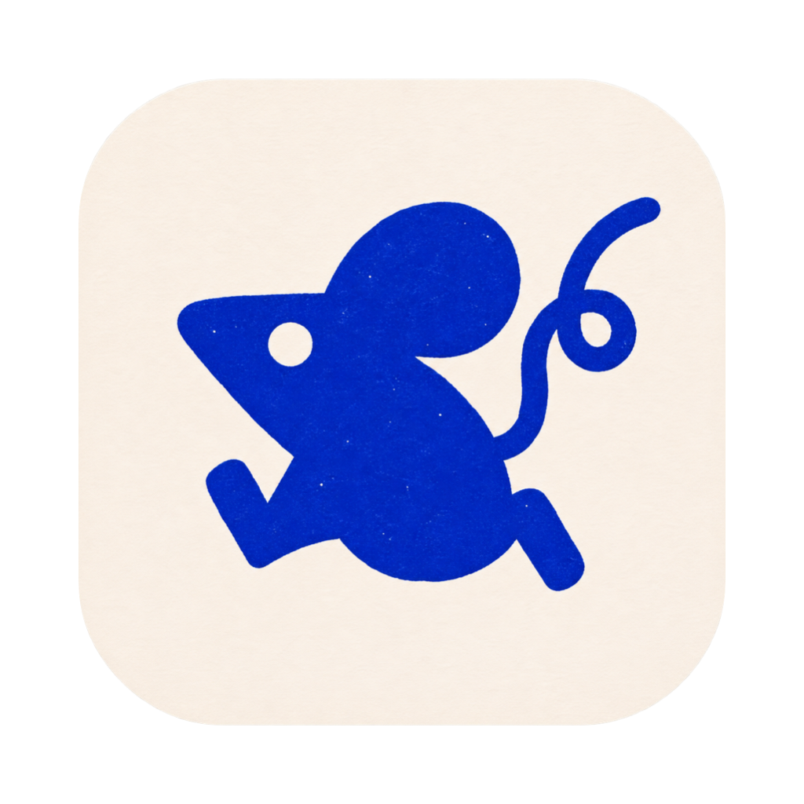

# Mice



Личный экран блокировки для macOS. Соберите композицию из фотографий, текста, заметок, часов и таймеров, и Mice покажет её поверх системных обоев, когда вы заблокируете Mac.

Можно оставить напоминание на утро, добавить фотографию или поставить обратный отсчёт до поездки. Редактор работает офлайн, а композиция сохраняется автоматически на вашем Mac.

**Требуется macOS 15 или новее.** Показ на блокировке экспериментальный: он использует приватные функции macOS и может перестать работать после обновления системы. Ручная проверка пройдена на macOS 15.7.3 с Apple Silicon. Для Intel доступна сборка, но показ на блокировке пока не проверен.

## Установка

Готовые сборки Mice пока не опубликованы в [GitHub Releases](https://github.com/BarryShepard/LockScreenWidget/releases). Приложение можно собрать на Mac с установленными Command Line Tools for Xcode.

Если инструментов разработчика ещё нет, выполните команду и дождитесь завершения установки в открывшемся окне:

```sh
xcode-select --install
```

Затем скачайте исходники и соберите приложение:

```sh
git clone https://github.com/BarryShepard/LockScreenWidget.git
cd LockScreenWidget
bash scripts/build.sh
open build/Mice.app
```

По умолчанию скрипт собирает приложение для Apple Silicon. Для Intel или переноса между Mac соберите универсальную версию:

```sh
bash scripts/build.sh --universal
open build/Mice.app
```

Готовое `build/Mice.app` можно перенести в папку «Программы». Сборка имеет локальную подпись, без Developer ID и нотариального заверения Apple. При переносе скачанного приложения на другой Mac система может заблокировать первый запуск; пояснения есть в [инструкции Apple](https://support.apple.com/ru-ru/102445).

## Первый запуск

1. В открывшемся редакторе выберите элемент в меню «Добавить», затем щёлкните по холсту, чтобы разместить его. Для фотографии откроется выбор файла.
2. Перетащите элемент в нужное место. Справа настройте размер, цвет, шрифт и другие свойства. У таймера можно задать свою дату, время и часовой пояс.
3. Нажмите на иконку мыши в строке меню и выберите «Проверить прозрачную панель (8 секунд)». Редактор временно скроется, и вы увидите композицию поверх рабочего стола.
4. В том же меню оставьте включённым «Показывать при блокировке» и заблокируйте Mac сочетанием **Control-Command-Q**.

После разблокировки композиция исчезнет. Закрытие окна редактора оставляет Mice работающим в строке меню. Открыть окно снова можно пунктом «Открыть редактор экрана», а выйти из приложения через «Завершить».

До первого изменения композиции Mice показывает встроенный отсчёт до ближайшей даты из каталога предсказаний конца света. После редактирования используется ваша композиция; удаление всех элементов оставляет экран пустым.

### Системные часы и поле входа

Часы, Touch ID и поле пароля остаются под управлением macOS. Чтобы убрать большие системные часы, откройте «Системные настройки», затем «Экран блокировки» и установите «Показывать большие часы» в «Никогда».

Ориентиры часов и входа в редакторе помогают оставить место для системных элементов. На самой блокировке ориентиры не отображаются, а их положение может отличаться от реального интерфейса macOS.

## Работа с композицией

- Текст и заметки. Меняйте шрифт, цвет и выравнивание. Enter или двойной щелчок по тексту открывает ввод; Escape завершает его.
- Фотографии. Меняйте размер, поворот и скругление углов. Для обрезки начните тянуть край фотографии с зажатой Command.
- Часы. Добавляйте время с нужным часовым поясом.
- Таймеры. Задавайте свою дату или выбирайте источник «Конец света» для автоматического отсчёта по встроенному каталогу. Доступны дни с временем, суммарные часы или только дни.
- Слои и группы. Меняйте порядок элементов, объединяйте их для совместного перемещения и блокируйте слой замком, чтобы случайно не сдвинуть его на холсте.

Встроенный каталог содержит опубликованные предсказания, а не прогноз приложения. Источники и оговорки собраны в [исследовании](research/README.md).

### Полезные сочетания

Сочетания ниже работают, когда фокус находится на холсте. Во время ввода текста обычные команды редактируют текст.

| Действие | Клавиши или жест |
| --- | --- |
| Разместить текст | T, затем щелчок; протягивание задаёт ширину блока |
| Выделить несколько элементов | Рамка с пустого места или Shift и щелчок |
| Переместить выделение | Стрелки на 1 pt, с Shift на 10 pt |
| Двигать строго по одной оси | Shift при перетаскивании |
| Сохранить пропорции при изменении размера | Shift при перетаскивании края или угла |
| Масштабировать пропорционально от центра | Option при изменении размера |
| Сгруппировать / разгруппировать | Command-G / Command-Shift-G |
| Дублировать | Command-D |
| Удалить | Delete |
| Отменить / повторить | Command-Z / Command-Shift-Z |
| Отменить размещение или снять выделение | Escape |

## Ограничения

- Композиция закрепляется за главным дисплеем при запуске. Выбора другого экрана пока нет; при отключении целевого дисплея композиция на другой не переносится. Работа на внешнем мониторе с закрытой крышкой пока не поддержана.
- Возможны пропадания панели при длительной блокировке. Сон, пробуждение и другие версии macOS требуют дополнительной проверки.
- Mice работает в запущенном пользовательском сеансе. На загрузочном экране FileVault композиции нет. После перезагрузки приложение нужно открыть заново; встроенной автозагрузки нет.

Известные проблемы и планы перечислены в [бэклоге](docs/backlog.md).

## Данные и удаление

Композиция хранится в `~/Library/Application Support/LockScreenWidget/scene.json`, а копии импортированных фотографий в соседней папке `Assets`. После импорта исходные фотографии можно перемещать. Для резервной копии сохраните всю папку `LockScreenWidget`.

Если файл композиции повреждён или папка недоступна, редактор сообщит об ошибке. В этом случае изменения останутся только в памяти и после выхода потеряются; исходный файл приложение не перезапишет.

Mice не запрашивает доступ к записи экрана или универсальному доступу. Журнал `~/Library/Logs/TEotW/diagnostics.log` содержит события блокировки и состояние панели. Пароли, нажатия клавиш и содержимое других окон не собираются.

Чтобы удалить приложение, завершите Mice через иконку мыши и удалите его из «Программ». Если сохранённая композиция и журнал больше не нужны, удалите папки `~/Library/Application Support/LockScreenWidget` и `~/Library/Logs/TEotW`. Старые имена папок сохранены для совместимости.

## Если композиция не появилась

Убедитесь, что Mice запущен и пункт «Показывать при блокировке» включён. Затем проверьте прозрачную панель через меню мыши. Если панель видна на рабочем столе, но отсутствует после блокировки, [создайте issue](https://github.com/BarryShepard/LockScreenWidget/issues) с версией macOS, моделью Mac, подключёнными дисплеями и описанием того, когда возникает проблема. При необходимости приложите соответствующий фрагмент журнала диагностики.

## Для разработчиков

Тесты запускаются командой `bash scripts/test.sh`. Для создания универсальных DMG и ZIP выполните `bash scripts/package.sh`: скрипт запустит тесты, соберёт приложение и сохранит пакеты в `build/Distribution`.

[История изменений](CHANGELOG.md) · [Спецификация редактора](docs/editor-spec.md) · [Проверка показа на блокировке](docs/native-editor-stage-d-verification.md)
